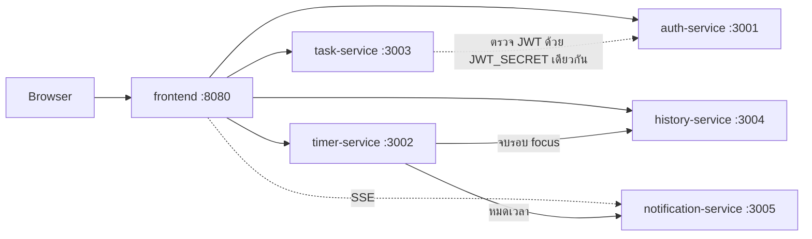

# Pomodoro Timer (Microservices)

เว็บจับเวลา Pomodoro (โฟกัส 25 นาที สลับพัก) อ้างอิงหน้าตาจาก [pomofocus.io](https://pomofocus.io/) แบ่งเป็น 5 microservices + 1 frontend อยู่ใน repo เดียว งานกลุ่มวิชา "วางโครงโปรเจกต์และ Deploy ระบบ"

[](https://github.com/POTAEPT/Deployment-FinalProject/actions/workflows/auth-service.yml)
[](https://github.com/POTAEPT/Deployment-FinalProject/actions/workflows/timer-service.yml)
[](https://github.com/POTAEPT/Deployment-FinalProject/actions/workflows/task-service.yml)
[](https://github.com/POTAEPT/Deployment-FinalProject/actions/workflows/history-service.yml)
[](https://github.com/POTAEPT/Deployment-FinalProject/actions/workflows/notification-service.yml)
[](https://github.com/POTAEPT/Deployment-FinalProject/actions/workflows/frontend.yml)
[](https://github.com/POTAEPT/Deployment-FinalProject/actions/workflows/integration-tests.yml)

## ภาพรวมระบบ



| Service | Port | หน้าที่ | เจ้าของ | Docker Hub |
|---|---|---|---|---|
| auth-service | 3001 | สมัคร / Login ออก JWT (users เก็บเป็นไฟล์ JSON บน Docker volume) | Potae | [`npotae/auth-service`](https://hub.docker.com/r/npotae/auth-service) |
| timer-service | 3002 | จับเวลา start / pause / resume / reset คำนวณ `endTime` | IQ | [`npotae/timer-service`](https://hub.docker.com/r/npotae/timer-service) |
| task-service | 3003 | รายการงาน (ต้อง login) | Dew | [`npotae/task-service`](https://hub.docker.com/r/npotae/task-service) |
| history-service | 3004 | สรุปจำนวนรอบและเวลาโฟกัสรายวัน | Mon | [`npotae/history-service`](https://hub.docker.com/r/npotae/history-service) |
| notification-service | 3005 | ส่งแจ้งเตือนให้เบราว์เซอร์ผ่าน SSE | Aom | [`npotae/notification-service`](https://hub.docker.com/r/npotae/notification-service) |
| frontend | 8080 | หน้าเว็บ (React + Vite) เสิร์ฟด้วย nginx | ทุกคน (แบ่งตาม component) | [`npotae/frontend`](https://hub.docker.com/r/npotae/frontend) |

ทุก image มีเวอร์ชัน `1.0.0` และ `latest` ไม่มี Database (ตามข้อกำหนด) ข้อมูลนอกจาก users อยู่ใน memory หายเมื่อ restart

## เริ่มใช้งาน

ต้องมี Docker (พร้อม docker compose)

```bash
docker compose up -d --build --wait   # build และรันทั้ง 6 ตัว รอจน healthcheck ผ่าน
```

เปิด http://localhost:8080 แล้ว login ด้วยบัญชีทดสอบ `demo1` / `Passw0rd!` (หรือ `demo2`) หรือสมัครใหม่ก็ได้

ปิดระบบด้วย `docker compose down` (users ที่สมัครไว้ยังอยู่) หรือ `docker compose down -v` (ลบ users ที่สมัครไว้ด้วย)

**ทดลองหรือ demo โดยไม่ต้องรอ 25 นาที:** ตั้งเวลา focus ให้สั้นลง

```bash
FOCUS_SECONDS=10 docker compose up -d --build --wait
```

ตั้ง `SHORT_BREAK_SECONDS` และ `LONG_BREAK_SECONDS` ได้เหมือนกัน ไม่ตั้ง = 1500 / 300 / 900 วินาที

## พัฒนาทีละ service

แต่ละ service อยู่ใน `backend/<service>/` รันแยกได้:

```bash
cd backend/auth-service
cp .env.example .env      # มีใน service ที่ต้องใช้ env (เช่น JWT_SECRET=dev-secret)
npm install
npm run dev               # รีสตาร์ทเองเมื่อแก้โค้ด
npm test                  # unit test
npm run build             # build เป็น dist/
```

frontend: `cd frontend && cp .env.example .env && npm install && npm run dev` แล้วเปิด http://localhost:5173 (ต้องมี backend รันอยู่) ดูกติกาการแบ่งงานและวิธีใช้ component กลางที่ [`frontend/README.md`](frontend/README.md)

## การทดสอบ

| ชั้น | อยู่ที่ | ใครเขียน | รันยังไง | รันใน CI |
|---|---|---|---|---|
| Unit | `backend/<service>/src/**/*.test.ts` | เจ้าของ service | `npm test` ในโฟลเดอร์ service | job `test` ของ service |
| API + Integration | `tests/` | Tester | ยก backend ด้วย compose แล้ว `cd tests && npm test` | job `integration-tests` |

```bash
FOCUS_SECONDS=3 docker compose up -d --build --wait auth-service timer-service task-service history-service notification-service
cd tests && npm ci && FOCUS_SECONDS=3 npm test
```

เคสทดสอบทั้งหมดอยู่ที่ [`docs/test-spec.md`](docs/test-spec.md) ผลการทดสอบและคำอธิบายแต่ละชั้นอยู่ที่ [`docs/test-report.md`](docs/test-report.md)

## CI/CD และ Release

| Workflow | รันเมื่อ | ทำอะไร |
|---|---|---|
| `<service>.yml` (5 ตัว) และ `frontend.yml` | PR / push `main` ที่แก้ไฟล์ของ service นั้น | test (+ lint สำหรับ frontend) → build, PR ลอง build image |
| | push tag `<service>-vX.Y.Z` | build image แล้ว push ขึ้น Docker Hub (`<version>` + `latest`) |
| `integration-tests.yml` | PR / push `main` ที่แก้ `backend/`, `tests/` หรือ `docker-compose.yml` | ยก backend ด้วย compose (`FOCUS_SECONDS=3`) แล้วรัน `tests/` |

release ทำด้วย git tag บน `main` เช่น:

```bash
git tag auth-service-v1.0.1
git push origin auth-service-v1.0.1
```

ใช้ GitHub Secrets `DOCKERHUB_USERNAME` และ `DOCKERHUB_TOKEN` ขั้นตอน Git ทั้งหมด (branch, PR, review, merge) อยู่ที่ [`docs/git-workflow.md`](docs/git-workflow.md)

## โครงสร้าง repo

```
.
├── backend/
│   ├── auth-service/          # แต่ละ service: src/ (+ unit test), Dockerfile, package.json
│   ├── timer-service/
│   ├── task-service/
│   ├── history-service/
│   └── notification-service/
├── frontend/                  # React + Vite + Tailwind, Dockerfile + nginx.conf
├── tests/                     # API + Integration test (Vitest)
├── docs/                      # เอกสารทั้งหมด
├── .github/workflows/         # pipeline ของแต่ละ service + integration-tests
├── docker-compose.yml         # รันทั้งระบบในเครื่อง
└── AGENTS.md                  # กติกาสำหรับ AI agent ที่ช่วยเขียนโค้ดใน repo นี้
```

## เอกสาร

| ไฟล์ | เนื้อหา |
|---|---|
| [`docs/project-overview.md`](docs/project-overview.md) | ภาพรวม เป้าหมาย ฟีเจอร์ และขอบเขต |
| [`docs/project-plan.md`](docs/project-plan.md) | บทบาท เฟสการทำงาน Milestone และ Issue |
| [`docs/architecture.md`](docs/architecture.md) | โครงสร้างระบบ service, port, tech stack |
| [`docs/system-design.md`](docs/system-design.md) | flow ภายใน (Login, Timer, SSE), การเก็บข้อมูล, pipeline |
| [`docs/api-contract.md`](docs/api-contract.md) | endpoint, request/response, status code, env variables |
| [`docs/design-system.md`](docs/design-system.md) | สี ฟอนต์ ปุ่ม component ของ UI |
| [`docs/git-workflow.md`](docs/git-workflow.md) | ขั้นตอน Git / PR / Release |
| [`docs/test-spec.md`](docs/test-spec.md) | เคสทดสอบทั้ง 36 เคส |
| [`docs/test-report.md`](docs/test-report.md) | ผลการทดสอบ และคำอธิบายแต่ละชั้นของการทดสอบ |

## ทีม

| บทบาท | สมาชิก |
|---|---|
| Project Manager (PM) | _ชื่อ_ |
| Tester | _ชื่อ_ |
| Developer | ทุกคน (1 คน 1 service ตามตารางด้านบน) |

## แก้ปัญหาที่เจอบ่อย

| อาการ | วิธีแก้ |
|---|---|
| `docker compose up` แล้ว port ชน (`address already in use`) | มีโปรแกรมอื่นใช้ port 3001–3005 / 8080 อยู่ ปิดก่อน หรือดูด้วย `docker ps` ว่ามี container เก่าค้างไหม |
| container ไม่ขึ้น `healthy` | ดูสาเหตุด้วย `docker compose logs <service>` |
| อยากล้าง users ที่สมัครไว้ | `docker compose down -v` (เหลือแค่ `demo1` / `demo2`) |
| ตั้ง `FOCUS_SECONDS` แล้วหน้าเว็บยังขึ้น `25:00` ก่อนกด START | ปกติ หน้าเว็บแสดงค่าตั้งต้น 25 นาทีจนกว่าจะกด START แล้วจึงใช้ค่าจาก server |
| "วันนี้" ใน history ไม่ตรงช่วงเที่ยงคืนถึงตี 7 | container ใช้เวลา UTC ตัวเลขยังถูกต้องแต่ยังนับเป็นวันก่อนหน้า |
| frontend ที่ deploy เครื่องอื่นเรียก API ไม่ได้ | URL ของ service ถูกฝังตอน build ต้อง build image ใหม่ด้วย `--build-arg VITE_AUTH_URL=...` (ดู `frontend/Dockerfile`) |
