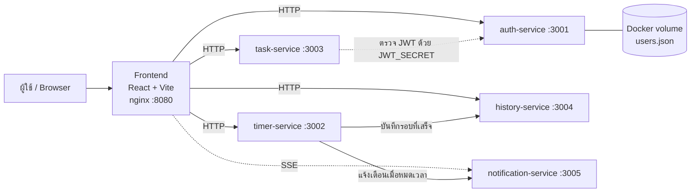

# Architecture

## ภาพรวม
Pomodoro Timer แบ่งเป็น **5 microservices + 1 frontend** อยู่ใน repo เดียว (monorepo) แต่ละ service แยก source, test, Dockerfile, pipeline และ version ของตัวเองอย่างอิสระ



เส้นประจาก task ไปหา auth หมายถึง **ไม่ได้เรียก API ตรงๆ** Task แค่ตรวจลายเซ็นของ token ด้วย secret ที่ตั้งตรงกัน

## รายการ Service

| Service | หน้าที่ | Port | เก็บข้อมูล |
|---|---|---|---|
| auth-service | สมัคร / Login ออก JWT | 3001 | ไฟล์ JSON บน Docker volume |
| timer-service | จัดการเวลา (start/pause/resume/reset) คำนวณ `endTime` | 3002 | memory |
| task-service | CRUD รายการงาน | 3003 | memory |
| history-service | สรุปรอบ Pomodoro และเวลาโฟกัสรายวัน | 3004 | memory |
| notification-service | รับเหตุการณ์แล้วส่งให้เบราว์เซอร์ผ่าน SSE | 3005 | memory (รายชื่อ client ที่เชื่อมอยู่) |
| frontend | UI ทั้งหมด (Login, Timer, Task, History, Notification) | 8080 | - |

ไม่มี Database ตามที่อาจารย์กำหนด ข้อมูลที่ต้องคงอยู่มีแค่ users สำหรับ Login ส่วนที่เหลืออยู่ใน memory หายเมื่อ restart ถือว่าปกติ

## โครงสร้าง repo

```
.
├── backend/
│   ├── auth-service/
│   ├── timer-service/
│   ├── task-service/
│   ├── history-service/
│   └── notification-service/
│       # แต่ละตัวมี src/ (รวม unit + API test *.test.ts), package.json, Dockerfile
├── frontend/
├── tests/                  # Integration test ข้าม service (Vitest ยิง localhost:300x หลัง docker compose up)
├── docs/                   # เอกสารทั้งหมด
├── .github/workflows/      # pipeline ของแต่ละ service + integration-tests
└── docker-compose.yml      # รันทั้งระบบในเครื่อง
```

Workflow ต้องอยู่ใน `.github/workflows/` ที่ root เท่านั้น (GitHub มองไม่เห็น workflow ที่อยู่ในโฟลเดอร์ย่อย) จึงใช้ `paths:` filter ให้แต่ละ pipeline ทำงานเฉพาะเมื่อไฟล์ของ service ตัวเองเปลี่ยน

## Tech Stack

| ส่วน | เทคโนโลยี |
|---|---|
| Frontend | React + Vite + TypeScript + Tailwind CSS, serve ด้วย nginx |
| Backend | Node.js 22 + Express + TypeScript |
| Auth | jsonwebtoken + bcryptjs |
| Real-time | Server-Sent Events (SSE) |
| Unit test | Vitest |
| API test | Vitest + supertest (ยิงเข้าแอปในโปรเซสเดียวกัน) |
| Integration test | Vitest ยิง HTTP ข้าม service ที่ยกด้วย docker compose |
| Container | Docker (multi-stage, `node:22-alpine`) + docker compose |
| CI/CD | GitHub Actions |
| Registry | Docker Hub |

## ทำไมออกแบบแบบนี้
- **แยก service ตามหน้าที่:** แต่ละคนรับผิดชอบ service ของตัวเอง ทำงานขนานกันโดยไม่ชนไฟล์กัน
- **Monorepo:** จัดการ repo เดียว ทุกคน clone ที่เดียว แต่ยังแยก pipeline และ image ต่อ service ได้
- **Frontend เรียก service ตรงๆ (ไม่มี API Gateway):** ลดจำนวนชิ้นส่วนให้ทีมเล็กทำทัน ต้องเปิด CORS ทุก service แทน
- **ไม่มี Database:** ตามข้อกำหนดของอาจารย์ และข้อมูลที่ต้องเก็บมีน้อย

ดูรายละเอียดการทำงานภายในได้ใน [system-design.md](system-design.md) และ endpoint ใน [api-contract.md](api-contract.md)