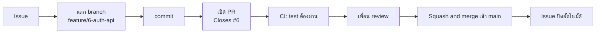

# Git Workflow

ทีมใช้ **GitHub Flow**: ทุกงานเริ่มจาก Issue → แตก branch → เปิด Pull Request (PR) → review → merge เข้า `main` ไม่มี branch `develop` แยก เพราะทีมเล็กและมี CI ตรวจก่อน merge อยู่แล้ว



## กฎสำคัญ
1. **ห้าม push ตรงเข้า `main`** (เปิด branch protection แล้ว) ทุกอย่างต้องผ่าน PR
2. **หนึ่ง issue = หนึ่ง branch = หนึ่ง PR**
3. PR ต้องผ่าน CI (job `test`) และมีคน review อย่างน้อย 1 คน (ไม่ใช่ตัวเอง) ก่อน merge
4. แก้เฉพาะโฟลเดอร์ service ของตัวเอง ถ้าต้องแก้ของคนอื่นหรือไฟล์กลาง ให้บอกเจ้าของก่อน
5. merge แล้วลบ branch ทิ้ง

## ตั้งชื่อ

| อะไร | รูปแบบ | ตัวอย่าง |
|---|---|---|
| Branch | `feature/<เลข issue>-<ชื่อสั้น>` | `feature/6-auth-api`, `feature/7-auth-unit-test` |
| Branch แก้บั๊ก | `fix/<เลข issue>-<ชื่อสั้น>` | `fix/21-timer-negative` |
| Commit | `<service>: <สิ่งที่ทำ>` | `auth: add login endpoint` |
| PR title | เหมือน title ของ issue | `[auth] ทำ API register / login` |
| Release tag | `<service>-vX.Y.Z` | `auth-service-v1.0.0`, `frontend-v1.0.0` |

ใน PR description ต้องเขียน `Closes #<เลข issue>` เพื่อให้ GitHub ปิด issue ให้เองเมื่อ merge

## ขั้นตอนทำงานจริง

```bash
# 1) ดึงโค้ดล่าสุดของ main ก่อนเริ่มงานเสมอ
git checkout main
git pull origin main

# 2) แตก branch ใหม่ตามเลข issue
git checkout -b feature/6-auth-api

# ... เขียนโค้ด ...

# 3) ดูว่าแก้อะไรไปบ้าง แล้ว commit
git status
git add backend/auth-service
git commit -m "auth: add login endpoint"

# 4) ส่ง branch ขึ้น GitHub แล้วไปเปิด PR บนเว็บ
git push -u origin feature/6-auth-api
```

คำสั่งเหล่านี้ทำอะไร:
- `git checkout main` / `git pull origin main`: สลับไป main แล้วดึงของล่าสุดจาก GitHub เพื่อให้ branch ใหม่เริ่มจากโค้ดที่ทันสมัย ลดโอกาสชนกับเพื่อน
- `git checkout -b <ชื่อ>`: สร้าง branch ใหม่และสลับไปทันที (`-b` = branch)
- `git add <โฟลเดอร์>`: เลือกเฉพาะไฟล์ที่จะ commit ระบุโฟลเดอร์ของ service ตัวเองจะไม่เผลอเอาไฟล์คนอื่นเข้ามา
- `git commit -m "..."`: บันทึกการเปลี่ยนแปลงพร้อมข้อความอธิบาย (`-m` = message)
- `git push -u origin <branch>`: ส่ง branch ขึ้น GitHub `-u` ผูก branch ในเครื่องกับบน GitHub ครั้งต่อไปพิมพ์แค่ `git push`

### ถ้า main เปลี่ยนระหว่างที่เราทำงานอยู่
```bash
git fetch origin
git merge origin/main
```
- `git fetch origin`: ดึงข้อมูลล่าสุดมาดูเฉยๆ ยังไม่แก้ไฟล์เรา
- `git merge origin/main`: รวมของล่าสุดจาก main เข้ามาใน branch เรา ถ้ามี conflict ให้แก้ไฟล์ตามที่ Git บอก แล้ว `git add` และ `git commit` อีกครั้ง

## ตอนเปิด PR ตรวจให้ครบ
- [ ] `npm test` ผ่านในเครื่อง
- [ ] PR เขียน `Closes #<เลข issue>`
- [ ] ไม่ได้ commit `node_modules/`, `dist/`, `.env`, `data/users.json`
- [ ] แก้เฉพาะไฟล์ของ service/issue นี้
- [ ] ถ้าแก้ API ให้อัปเดต `docs/api-contract.md` และแจ้ง Tester

## Merge
- ใช้ **Squash and merge** (รวมทุก commit ใน PR เป็น commit เดียวบน main ประวัติสะอาดอ่านง่าย)
- หลัง merge ให้กดลบ branch แล้วที่เครื่องรัน `git checkout main && git pull origin main`

## Release
เมื่อ service พร้อมออกเวอร์ชัน (บน main แล้ว) ให้สร้าง tag:

```bash
git checkout main
git pull origin main
git tag auth-service-v1.0.0
git push origin auth-service-v1.0.0
```
- `git tag <ชื่อ>`: ติดป้ายเวอร์ชันที่ commit ปัจจุบัน
- `git push origin <ชื่อ tag>`: ส่งป้ายขึ้น GitHub ซึ่งเป็นตัวสั่งให้ job `release` build image แล้วส่งขึ้น Docker Hub

เลขเวอร์ชัน `vMAJOR.MINOR.PATCH`: แก้บั๊กเล็กน้อยเพิ่มเลขท้าย (1.0.1) เพิ่มฟีเจอร์ใหม่เพิ่มเลขกลาง (1.1.0) เปลี่ยน API จนของเดิมใช้ไม่ได้เพิ่มเลขหน้า (2.0.0)

## ถ้าติดปัญหา
| อาการ | วิธีแก้ |
|---|---|
| push เข้า main ไม่ได้ | ถูกต้องแล้ว ต้องเปิด PR |
| CI ไม่รัน | เช็คว่าแก้ไฟล์ใน `backend/<service>/` (workflow ใช้ `paths:` กรองอยู่) |
| conflict | `git fetch origin` แล้ว `git merge origin/main` แก้ไฟล์ที่ชนกัน |
| commit ผิดที่ (ลืมแตก branch) | แจ้ง PM ก่อน อย่าลองแก้เองด้วย `git reset --hard` เพราะอาจทำงานหาย |