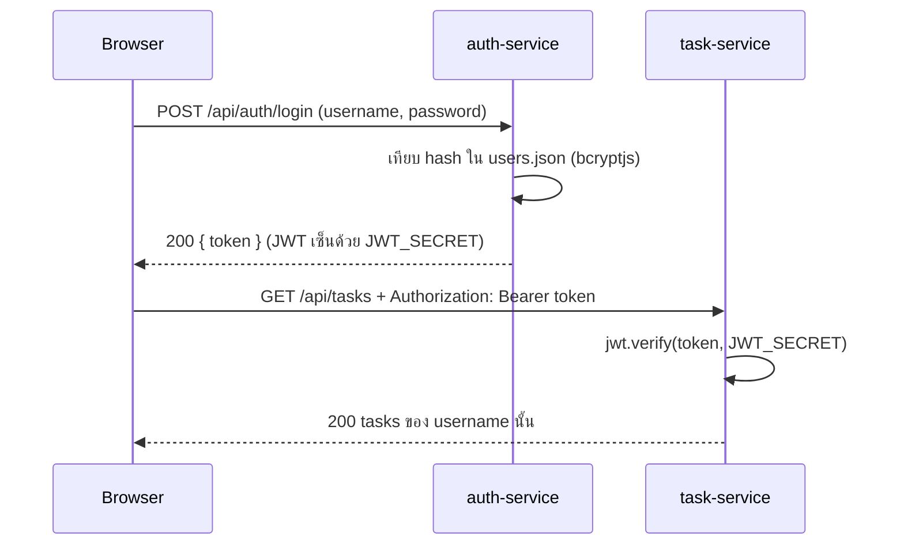
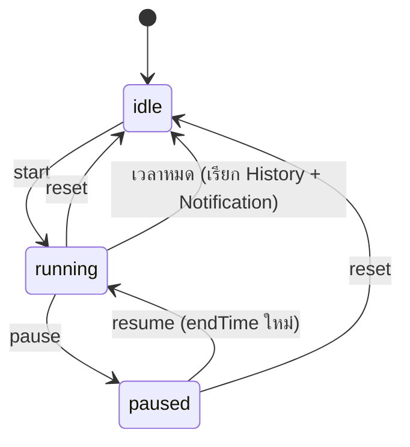
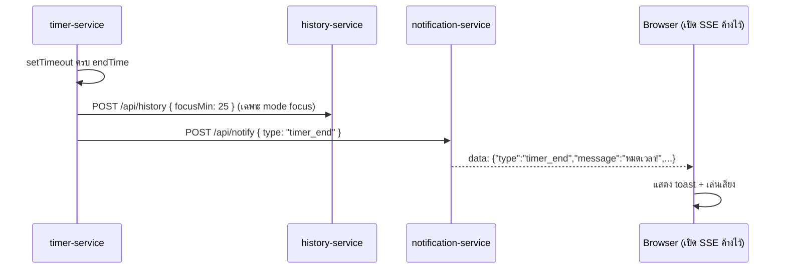
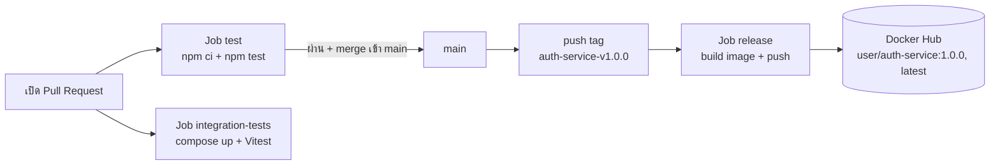

# System Design

อธิบาย **การทำงานภายใน** และการตัดสินใจออกแบบ (ดูโครงสร้างภาพรวมที่ [architecture.md](architecture.md))

## 1. Flow การ Login และตรวจสิทธิ์

- Task **ไม่เรียก** Auth เพื่อตรวจ token เพราะ JWT ตรวจเองได้ด้วย secret เดียวกัน ทำให้ Task ไม่พึ่ง Auth ตอนทำงาน
- ต้องตั้ง `JWT_SECRET` ให้ตรงกันใน `docker-compose.yml`
- Frontend เก็บ token ไว้ใน memory/localStorage แล้วแนบทุก request ที่ต้อง Login

## 2. Timer: ทำไม server ส่ง `endTime`

ปัญหา: ถ้า frontend นับถอยหลังเอง แล้วผู้ใช้รีเฟรชหน้าหรือแท็บถูกพักการทำงาน เวลาจะเพี้ยน

แนวทาง: server เก็บ **เวลาสิ้นสุดแน่นอน (`endTime`)** แล้วให้ frontend คำนวณ `timeLeft = endTime - เวลาปัจจุบัน` ทุกวินาที รีเฟรชแล้วเรียก `GET /api/timer/status` ได้ค่าเดิมต่อทันที

- ตอน start/resume server ตั้ง `setTimeout` ไว้ถึง `endTime`; ตอน pause/reset ต้อง `clearTimeout`
- pause เก็บ `timeLeft` ที่เหลือ, resume คำนวณ `endTime = ตอนนี้ + timeLeft`
- เวลาเริ่มต้นปรับด้วย env เพื่อให้ทดสอบ integration ได้โดยไม่ต้องรอ 25 นาที

## 3. Flow เมื่อเวลาหมด

- การเรียก History/Notification เป็นแบบ **best-effort**: ล้มเหลวแล้วแค่ log ไม่ทำให้ Timer พัง
- Frontend เปิด SSE ไปที่ Notification ครั้งเดียวตอนเข้าระบบ แล้วรอรับ event

## 4. Notification ด้วย SSE
- Browser เปิด `GET /api/notify/stream` ค้างไว้ (ใช้ `EventSource` ของ browser)
- Server เก็บ `res` ของทุก client ไว้ใน array แล้ว `res.write("data: ...\n\n")` ทุกครั้งที่มี event
- ตอน client ปิด connection (`req.on("close")`) ต้องลบออกจาก array ไม่งั้น memory รั่ว
- เลือก SSE แทน WebSocket เพราะส่งทางเดียว (server → browser) เพียงพอ และง่ายกว่า

## 5. การเก็บข้อมูล

| ข้อมูล | อยู่ที่ไหน | เหตุผล |
|---|---|---|
| users (Login) | ไฟล์ JSON บน Docker volume | เป็นข้อมูลเดียวที่ต้องคงอยู่ข้าม restart และให้ทุกคนใช้บัญชีเดียวกัน Login ได้ |
| timer, task, history, SSE clients | memory | ไม่มี Database ตามข้อกำหนด ข้อมูลหายเมื่อ restart |

- รหัสผ่านเก็บเป็น hash เท่านั้น
- มี `users.seed.json` สำหรับบัญชีทดสอบ (hash แล้ว ใช้เฉพาะ test) ถ้ายังไม่มีไฟล์บน volume จะคัดลอกจาก seed
- test ทุกชั้นต้องสร้างข้อมูลของตัวเอง ห้ามพึ่งข้อมูลเดิมที่ค้างอยู่

## 6. การจัดการ Error
- ทุก service ตอบรูปแบบเดียวกัน `{ "status": "error", "message": "..." }`
- ใช้ status code ตามตารางใน [api-contract.md](api-contract.md)
- Input ต้อง validate ที่ขอบ service (เช็ค type/ค่าว่าง/ช่วงค่า) ก่อนเข้าตรรกะหลัก

## 7. การ Deploy และ Pipeline

- ทุก service มี workflow ของตัวเอง ใช้ `paths:` ให้รันเฉพาะเมื่อไฟล์ของ service นั้นเปลี่ยน
- Release ทำด้วย **git tag** รูปแบบ `<service>-vX.Y.Z` แล้ว workflow สร้าง image ชื่อ `<DOCKERHUB_USERNAME>/<service>` พร้อม tag เวอร์ชันและ `latest`
- Secrets ที่ใช้: `DOCKERHUB_USERNAME`, `DOCKERHUB_TOKEN`
- `integration-tests` รัน `docker compose up -d --build --wait` (รอจน healthcheck `/health` ผ่าน) (เฉพาะ backend, `FOCUS_SECONDS=3`) แล้วรัน Vitest ใน `tests/` ยิง API จริง ทั้งเคส API และ Integration

## 8. ทดสอบ

| ชั้น | เครื่องมือ | ผู้เขียน | ทดสอบอะไร |
|---|---|---|---|
| Unit | Vitest (ในโฟลเดอร์ service) | Developer ของแต่ละ service | ฟังก์ชันเดี่ยว ไม่ใช้ network รันใน job `test` ของ service |
| API | Vitest (`tests/` ที่ root) | Tester | endpoint ของแต่ละ service ตาม Test Spec ยิง `http://localhost:300x` หลัง `docker compose up` รันใน job `integration-tests` |
| Integration | Vitest (`tests/` ที่ root) | Tester | การทำงานข้าม service (IT-01 ถึง IT-04) รันใน job `integration-tests` เช่นกัน |

ดูรายการเคสทั้งหมดที่ [test-spec.md](test-spec.md)