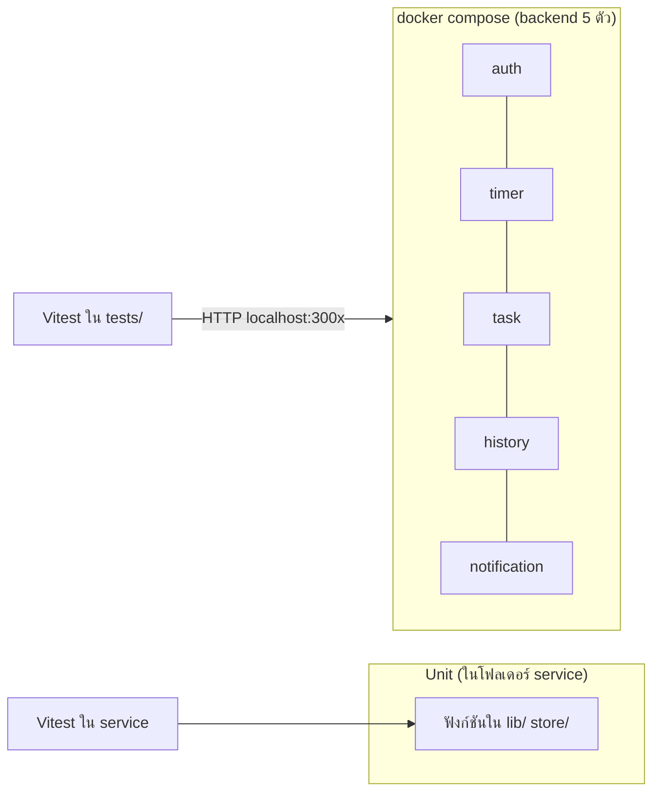

# Test Report – Pomodoro Timer (Microservices)

รายงานผลการทดสอบของทั้งระบบ อ่านคู่กับ [test-spec.md](test-spec.md) (รายการเคส) ถ้าเพิ่ม/แก้เทสต์ให้อัปเดตไฟล์นี้ผ่าน Pull Request

## สรุปผล

| หัวข้อ | ผล |
|---|---|
| วันที่ทดสอบ | 2026-10-15 |
| Commit ที่ทดสอบ | `fd495c4` (main หลัง merge #62) |
| เคสใน Test Spec | **36 / 36 ผ่าน** (Unit 10, API 22, Integration 4) |
| Unit test ทั้งหมด (รวมเคสนอก Test Spec) | **62 / 62 ผ่าน** ใน 5 service |
| API + Integration test | **26 / 26 ผ่าน** บน GitHub Actions ([run บน main](https://github.com/POTAEPT/Deployment-FinalProject/actions/runs/38740669398)) |
| CI ล่าสุดบน main | ทุก workflow ผ่าน (auth, timer, task, history, notification, frontend, integration-tests) |

## ชั้นของการทดสอบ (อ่านก่อนถ้ายังไม่คุ้น)

โปรเจกต์นี้ทดสอบ 3 ชั้น แต่ละชั้นตอบคำถามต่างกัน:

| ชั้น | ทดสอบอะไร | ยิงอะไร | ตัวอย่างจากโปรเจกต์ |
|---|---|---|---|
| **Unit** | ฟังก์ชันเดี่ยวๆ ข้างใน service | เรียกฟังก์ชันตรงๆ ไม่มี network ไม่ต้องเปิด service | `calcEndTime(10:00, 1500)` ต้องได้ `10:25` |
| **API** | endpoint ของ **service เดียว** ตอบถูกตาม [api-contract.md](api-contract.md) ไหม | HTTP ไปที่ service จริงที่ยกด้วย docker compose | `POST /api/auth/register` ซ้ำต้องได้ `409` |
| **Integration** | หลาย service **ทำงานต่อกัน** ถูกไหม | HTTP ข้าม service แล้วดูผลที่อีก service | timer จบรอบ focus แล้ว history ต้องนับเพิ่ม 1 |



ทำไมต้องหลายชั้น: unit test เร็วและบอกได้ชัดว่าฟังก์ชันไหนผิด แต่ไม่รู้ว่า endpoint และการเชื่อมต่อระหว่าง service ใช้ได้จริงไหม ส่วน API / Integration test เช็คของจริงทั้งระบบ แต่ช้ากว่าและต้องยก Docker

## สภาพแวดล้อม

| หัวข้อ | ค่า |
|---|---|
| Runtime | Node.js 22 |
| เครื่องมือ | Vitest 5 (ทุกชั้น), `fetch` ของ Node สำหรับ API / Integration |
| ระบบที่ทดสอบ | `docker compose` ยกเฉพาะ backend 5 service (ไม่รวม frontend) |
| ค่าเวลา timer | `FOCUS_SECONDS=3` (short / long break ใช้ค่าปกติ 300 / 900) |
| CI | GitHub Actions `ubuntu-latest` workflow `integration-tests` (timeout 15 นาที) |

## ผลแยกตาม service

| Service | Unit test (ไฟล์ / เคส) | เคส Unit ใน Test Spec | เคส API ใน Test Spec | ผล |
|---|---|---|---|---|
| auth-service | 3 ไฟล์ / 12 เคส | TS-01-05, 06 | TS-01-01, 02, 03, 04, 07 | ✅ |
| timer-service | 2 ไฟล์ / 16 เคส | TS-02-05, 06 | TS-02-01, 02, 03, 04, 07 | ✅ |
| task-service | 3 ไฟล์ / 14 เคส | TS-03-05, 06 | TS-03-01, 02, 03, 04, 07 | ✅ |
| history-service | 1 ไฟล์ / 9 เคส | TS-04-04, 05 | TS-04-01, 02, 03, 06 | ✅ |
| notification-service | 1 ไฟล์ / 11 เคส | TS-05-03, 04 | TS-05-01, 02, 05 | ✅ |
| ข้าม service | - | - | IT-01, 02, 03, 04 | ✅ |
| **รวม** | **10 ไฟล์ / 62 เคส** | **10** | **22 + IT 4** | **✅ ทั้งหมด** |

unit test มีมากกว่าที่ Test Spec กำหนด (62 เทียบกับ 10) เพราะแต่ละคนเทสต์กรณีเพิ่มเอง เช่น token เซ็นด้วย secret อื่น, timer ไม่จบก่อนเวลา, task ของแต่ละ user แยกกัน

## ผลรายเคส

ชื่อเทสต์ใน `tests/` ขึ้นต้นด้วย Test ID ค้นหาในโค้ดหรือใน log ของ CI ได้ทันที

### TS-01 Auth
| Test ID | Type | เคส | หลักฐาน (ไฟล์ › ชื่อเทสต์) | ผล |
|---|---|---|---|---|
| TS-01-01 | API | สมัครสมาชิกสำเร็จ | `tests/auth.test.ts` › TS-01-01 | ✅ |
| TS-01-02 | API | สมัครด้วย username ซ้ำ | `tests/auth.test.ts` › TS-01-02 | ✅ |
| TS-01-03 | API | Login สำเร็จ ได้ token | `tests/auth.test.ts` › TS-01-03 | ✅ |
| TS-01-04 | API | Login รหัสผ่านผิด | `tests/auth.test.ts` › TS-01-04 | ✅ |
| TS-01-05 | Unit | hash รหัสผ่านด้วย bcrypt | `backend/auth-service/src/lib/password.test.ts` › hash แล้วไม่เท่ากับรหัสเดิม และ compare กับรหัสเดิมได้ true | ✅ |
| TS-01-06 | Unit | ตรวจ JWT ที่หมดอายุ/ปลอม | `backend/auth-service/src/lib/token.test.ts` › token ปลอมได้ null, token หมดอายุได้ null | ✅ |
| TS-01-07 | API | Login โดยไม่ส่ง password | `tests/auth.test.ts` › TS-01-07 | ✅ |

### TS-02 Timer
| Test ID | Type | เคส | หลักฐาน | ผล |
|---|---|---|---|---|
| TS-02-01 | API | เริ่ม Pomodoro (focus) | `tests/timer.test.ts` › TS-02-01 | ✅ |
| TS-02-02 | API | เริ่มโหมด short break | `tests/timer.test.ts` › TS-02-02 | ✅ |
| TS-02-03 | API | Pause แล้ว Resume | `tests/timer.test.ts` › TS-02-03 | ✅ |
| TS-02-04 | API | Reset timer | `tests/timer.test.ts` › TS-02-04 | ✅ |
| TS-02-05 | Unit | คำนวณ endTime | `backend/timer-service/src/lib/timer.test.ts` › calculates endTime from the current time and seconds remaining | ✅ |
| TS-02-06 | Unit | คำนวณ timeLeft ไม่ติดลบ | `backend/timer-service/src/lib/timer.test.ts` › does not return a negative timeLeft for an elapsed endTime | ✅ |
| TS-02-07 | API | mode ไม่ถูกต้อง | `tests/timer.test.ts` › TS-02-07 | ✅ |

### TS-03 Task
| Test ID | Type | เคส | หลักฐาน | ผล |
|---|---|---|---|---|
| TS-03-01 | API | เพิ่ม task ใหม่ | `tests/task.test.ts` › TS-03-01 | ✅ |
| TS-03-02 | API | ดึงรายการ task | `tests/task.test.ts` › TS-03-02 | ✅ |
| TS-03-03 | API | ติ๊ก task ว่าเสร็จ | `tests/task.test.ts` › TS-03-03 | ✅ |
| TS-03-04 | API | ลบ task | `tests/task.test.ts` › TS-03-04 | ✅ |
| TS-03-05 | Unit | title ว่างต้องถูกปฏิเสธ | `backend/task-service/src/lib/task.test.ts` › title ว่างไม่ผ่าน (คืน null) | ✅ |
| TS-03-06 | Unit | toggle สถานะ completed | `backend/task-service/src/lib/task.test.ts` › สลับ completed จาก false เป็น true | ✅ |
| TS-03-07 | API | เรียกโดยไม่มี token | `tests/task.test.ts` › TS-03-07 | ✅ |

### TS-04 History
| Test ID | Type | เคส | หลักฐาน | ผล |
|---|---|---|---|---|
| TS-04-01 | API | บันทึก pomodoro ที่เสร็จ | `tests/history.test.ts` › TS-04-01 | ✅ |
| TS-04-02 | API | ดูสรุปรายวัน | `tests/history.test.ts` › TS-04-02 | ✅ |
| TS-04-03 | API | วันที่ไม่มีข้อมูล | `tests/history.test.ts` › TS-04-03 | ✅ |
| TS-04-04 | Unit | รวม focus minutes | `backend/history-service/src/lib/history.test.ts` › sums focus minutes | ✅ |
| TS-04-05 | Unit | จัดรูปแบบวันที่เป็น ISO | `backend/history-service/src/lib/history.test.ts` › formats a Date as YYYY-MM-DD | ✅ |
| TS-04-06 | API | focusMin ติดลบ | `tests/history.test.ts` › TS-04-06 | ✅ |

### TS-05 Notification
| Test ID | Type | เคส | หลักฐาน | ผล |
|---|---|---|---|---|
| TS-05-01 | API | ส่ง event แจ้งเตือนผ่าน API | `tests/notification.test.ts` › TS-05-01 | ✅ |
| TS-05-02 | API | Client รับ event ผ่าน SSE | `tests/notification.test.ts` › TS-05-02 | ✅ |
| TS-05-03 | Unit | สร้างข้อความตามประเภท | `backend/notification-service/src/lib/notification.test.ts` › returns the default message for focus_end | ✅ |
| TS-05-04 | Unit | type ไม่รู้จักต้องถูกปฏิเสธ | `backend/notification-service/src/lib/notification.test.ts` › rejects abc | ✅ |
| TS-05-05 | API | ส่ง type ไม่ถูกต้องผ่าน API | `tests/notification.test.ts` › TS-05-05 | ✅ |

### Integration
| Test ID | เคส | หลักฐาน | ผล |
|---|---|---|---|
| IT-01 | ใช้ token จาก Auth สร้าง task | `tests/integration.test.ts` › IT-01 | ✅ |
| IT-02 | token ปลอมถูก Task ปฏิเสธ | `tests/integration.test.ts` › IT-02 | ✅ |
| IT-03 | Timer จบแล้ว History นับเพิ่ม | `tests/integration.test.ts` › IT-03 (ใช้เวลา ~3.3 วินาที) | ✅ |
| IT-04 | Timer จบแล้วมี Notification | `tests/integration.test.ts` › IT-04 (ใช้เวลา ~3.0 วินาที) | ✅ |

## ข้อมูลทดสอบที่ต่างจาก Test Spec (และเหตุผล)

เทสต์ต้อง **รันซ้ำได้ทุกเมื่อ** โดยไม่ต้องล้างข้อมูล และ **ไม่พึ่งลำดับไฟล์** จึงปรับข้อมูลบางเคส (ผลที่คาดหวังเหมือนเดิม):

| เคส | Test Spec | ที่ใช้จริง | เหตุผล |
|---|---|---|---|
| TS-01-01, 02, 03, IT-01 | `testuser1` | `testuser1-<suffix>` ไม่ซ้ำทุกรอบ | รันรอบสองจะได้ 409 เพราะ user มีอยู่แล้ว (users อยู่บน volume) |
| TS-02-01 | `timeLeft=1500` | `timeLeft` = ค่า `FOCUS_SECONDS` (CI = 3) | CI ต้องย่อ focus ให้ IT-03 / IT-04 จบเร็ว |
| TS-02-03, 04 | timer กำลังทำงาน (ไม่ระบุโหมด) | โหมด `long_break` | focus 3 วินาทีจะจบก่อนกด pause |
| TS-04-02 | `date=2026-01-01` ได้ 2 / 50 | วันที่สุ่มในอดีต เทียบก่อน/หลัง +2 / +50 | รันซ้ำแล้วตัวเลขสะสม |
| TS-04-03 | `date=2000-01-01` | วันที่สุ่มช่วงปี 1900–1949 | ช่วงที่ไม่มีเคสไหนบันทึก จึงต้องได้ 0 จริง |
| TS-05-02 | `type=timer_end` | message ไม่ซ้ำ แล้วรอเฉพาะ event นั้น | ไม่สับสนกับ event อื่นที่เข้ามาพร้อมกัน |
| IT-03 | `pomodoroCount` เพิ่มขึ้น 1 | เทียบสรุปวันนี้ก่อน/หลัง | ไม่คาดว่าข้อมูลวันนี้เริ่มที่ 0 |
| IT-04 | ได้ event `timer_end` | รับเฉพาะ event ที่เกิดหลังกด start | กัน event เก่าที่ค้างอยู่ |

นอกจากนี้ timer มีตัวเดียวทั้งระบบ จึงรันเทสต์ทีละไฟล์ และ reset timer ก่อน/หลังทุกเคสที่ใช้ timer (ไม่งั้น focus ที่ค้างจะจบเองแล้วไปเพิ่ม history กวนเคสอื่น)

## การรันซ้ำและทดสอบให้พังโดยตั้งใจ

| การทดสอบ | ผล |
|---|---|
| รันกับระบบที่มีข้อมูลเก่าอยู่แล้ว | ✅ 26 / 26 |
| รันซ้ำติดกัน 2 รอบโดยไม่ล้างข้อมูล | ✅ 26 / 26 ทั้งสองรอบ |
| จำลอง CI: ระบบใหม่ (compose project แยก) ยกเฉพาะ backend + `npm ci` ใหม่ | ✅ 26 / 26 |
| **หยุด history-service** แล้วรัน | ❌ IT-03 และ TS-04 ทั้ง 4 เคส fail (ถูกต้อง) |
| **history ทำงาน แต่ชี้ `HISTORY_URL` ของ timer ผิด port** | ❌ IT-03 fail `expected +0 to be 1` (ถูกต้อง: timer บันทึก history ไม่ได้ เทสต์จับได้) |
| คืนค่าแล้วรันใหม่ | ✅ 26 / 26 |

การทดสอบให้พังยืนยันว่าเทสต์ **ตรวจผลจริง** ไม่ได้ผ่านเพราะแค่ service เปิดอยู่

## ข้อจำกัด / สิ่งที่ยังไม่ได้ทดสอบอัตโนมัติ

| เรื่อง | รายละเอียด | ทดสอบอย่างไรแทน |
|---|---|---|
| หน้าเว็บ (frontend) | ไม่มี UI automation (อยู่นอกขอบเขตตาม project-overview) CI ของ frontend ตรวจแค่ lint + build | ทดสอบด้วยมือบนเบราว์เซอร์ทั้ง flow: login / สมัคร, timer + สีพื้นหลัง, toast + เสียง, history นับเพิ่ม, เพิ่ม / ติ๊ก / ลบงาน, รีเฟรชระหว่างจับเวลา |
| "วันนี้" ของ history | container ใช้เวลา UTC ช่วงเที่ยงคืนถึงตี 7 (เวลาไทย) ยังนับเป็นวันก่อนหน้า | IT-03 ใช้ "วันนี้" ของ server ทั้งก่อนและหลัง จึงไม่กระทบผล |
| ตัวเลขบน TimerCard ก่อนกด START | หน้าเว็บแสดงค่าตั้งต้น 25:00 แม้ตั้ง `FOCUS_SECONDS` ต่างไป | ไม่กระทบการใช้งานจริง (ค่าปกติ) |
| HistorySummary หลังจบรอบ | หน้าเว็บโหลดสรุปใหม่ตอนนาฬิกาฝั่งเบราว์เซอร์ถึง 0 อาจเร็วกว่า server บันทึกเสร็จไม่กี่มิลลิวินาที | มีปุ่ม "รีเฟรช" ไว้แก้ |
| notification `message` ว่าง | ส่ง `"message": ""` ได้ toast ว่าง | timer ไม่เคยส่ง message จึงไม่เกิดในการใช้งานจริง |

## วิธีรันซ้ำ

**Unit test** (รันในแต่ละ service):

```bash
cd backend/<service> && npm ci && npm test
```

**API + Integration test**:

```bash
# ที่ root
FOCUS_SECONDS=3 docker compose up -d --build --wait auth-service timer-service task-service history-service notification-service
cd tests && npm ci && FOCUS_SECONDS=3 npx vitest run --reporter=verbose
```

`FOCUS_SECONDS` ตอนรันเทสต์ต้องเป็นค่าเดียวกับตอน `docker compose up` (TS-02-01 คาดหวังค่านี้) รายละเอียดเพิ่มเติมที่ [`tests/README.md`](../tests/README.md)

## วิธีเพิ่มเทสต์ใหม่

1. เพิ่มเคสใน [test-spec.md](test-spec.md) ก่อน (Test ID ใหม่, ขั้นตอน, ผลคาดหวัง, Status `Not Run`)
2. เลือกชั้น: ฟังก์ชันเดี่ยว → unit test ในโฟลเดอร์ service (เจ้าของ service เขียน) / endpoint หรือข้าม service → `tests/` (Tester เขียน)
3. ใน `tests/` ตั้งชื่อเทสต์ขึ้นต้นด้วย Test ID เช่น `it("TS-03-08 ...")` และใช้ helper ใน `tests/helpers.ts` (`api`, `createUserToken`, `historySummary`, `resetTimer`, `openSse`, `uniqueSuffix`, `randomDate`)
4. ข้อมูลต้องไม่ซ้ำทุกรอบ และเทียบก่อน/หลัง ห้ามคาดว่าเริ่มที่ 0 ห้ามพึ่งเคสอื่น ถ้าใช้ timer ให้ reset ก่อน/หลัง
5. รันผ่านในเครื่อง เปิด PR แล้วดู CI ผ่าน จากนั้นเปลี่ยน Status ใน test-spec เป็น `Pass` และอัปเดตรายงานนี้
